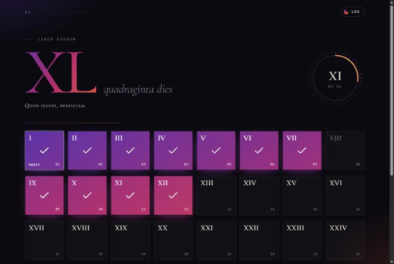

<div align="center">

# XL


*quadraginta dies*

**[◈ Enter →](https://forty-days-two.vercel.app/)**

<a href="https://forty-days-two.vercel.app/"></a>

<sub>[forty-days-two.vercel.app](https://forty-days-two.vercel.app/)</sub>

</div>

---

### Liber dierum

Forty boxes. Forty days.
One is filled each time a day is kept.

There is no explanation on the page, and there won't be one here either.
Whoever made it knows what it's for. That is enough.

---

### Why forty

Forty has always been the number of a passage.

Forty days of rain. Forty years in the desert.
And forty days in the wilderness, where Jesus went alone, without bread, and was tempted, and did not give in.

He did not wander there by accident. He went with a purpose, and he came out ready for what came next.

Forty days is long enough for a craving to lose its voice,
and short enough to see the end from the beginning.

---

### And you?

> **Do you have something in mind for the coming forty days?**

Something to leave behind. Something to begin. Something you've been putting off.

You don't have to tell anyone what it is.
Just count the days.

*Quod incepi, perficiam.*
What I have begun, I will finish.

---

<details>
<summary><sub>for the curious</sub></summary>

<br />

Built with Next.js. Your marks stay in your own browser and are never sent anywhere.

- **Tap** a box to keep a day.
- **Hold** it (or right-click) to mark a *lapsus*: a day you stumbled. It doesn't erase the others.
- **The theme toggle** cycles through ten themes. Each has its own day palette, title gradient, hairlines and a Vulgate verse:
  - **Nox** — night burning toward dawn (Rom. 13:12)
  - **Lux** — an illuminated manuscript on vellum (Gen. 1:3)
  - **Vesper** — sunset over the sea (Luke 24:29)
  - **Aurora** — a rose dawn (Song 6:9)
  - **Oliva** — collegiate green and gold, the Mount of Olives (Acts 1:3)
  - **Diluvium** — forty days of rain, then the rainbow (Gen. 7:12)
  - **Sinai** — forty days on the mountain in the fire (Ex. 24:18)
  - **Eremus** — forty days in the wilderness (Matt. 4:1)
  - **Cinis** — the ashes that open Lent (Gen. 3:19)
  - **Caelum** — the Ascension on the fortieth day (Acts 1:11)

```bash
npm install
npm run dev
```

</details>

<div align="center">

<sub>Per angusta ad augusta · MMXXVI</sub>

</div>
